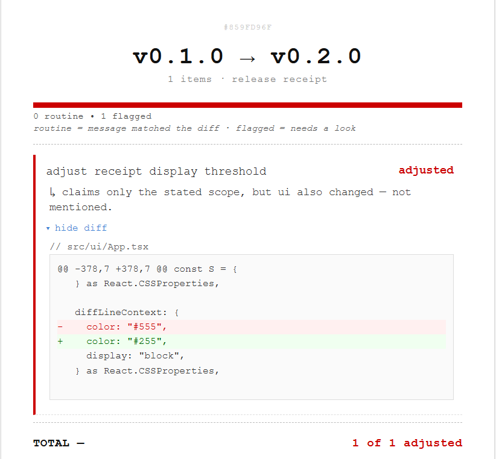

# FinePrint

Checks whether a release's commit messages actually match what the code changed.

Existing changelog tools (GitHub auto-notes, Release Drafter, semantic-release) summarize what commit messages say. None of them check whether those messages are telling the truth. FinePrint reads the real diff between two release tags and verifies each commit's message against what actually happened in the code.

## How it works

1. Paste a public GitHub repo URL and pick two tags to compare.
2. FinePrint fetches every commit between those tags, along with its full diff, using the Netlify Function proxy for GitHub's public REST API.
3. Each commit runs through three independent checks:
   - **Diff-vs-message mismatch** — extracts the areas of the codebase a commit's message claims to touch, compares that against which areas actually changed in the diff, and flags anything that changed but was never mentioned.
   - **Semver violation** — checks whether a patch or minor version bump secretly contains a breaking change (e.g. a removed export or changed function signature).
   - **Dependency bump** — flags any dependency manifest change with a major-version jump, regardless of what the commit message says.
4. Auto-generated, mechanical commits (release-plugin bumps, merge commits) are excluded automatically, so they never create false noise.
5. Results render as a release-level X-ray: every unique changed file is grouped by path-based category, connected to its associated commits, and expandable to the actual GitHub patch evidence. Findings remain rule-based and explain which check triggered them.

All analysis is rule-based and runs in the browser — no live AI call, account, or client-side secret is required. Production GitHub requests use the Netlify Function proxy, which keeps the optional server-side token out of frontend bundles and enforces public-repository access.

## Live Demo
**Live app:** [https://zesty-dasik-312180.netlify.app/]

## Built with IBM Bob 2.0
Built using Bob's Agent mode with full document understanding of the codebase. The three checks above were built as three parallel subagents — spawned simultaneously, each independently implemented and tested, then merged into a single verdict engine. Iterative hardening (real-data testing, UX fixes, performance tuning) was done across further Agent-mode tasks. See `bob_sessions/` for task-by-task evidence.

## Tech Stack
React, TypeScript, Vite, GitHub REST API, and Netlify Functions. No database or account is required.

## Validation
The repository includes regression coverage for release aggregation, renames, file statuses, unavailable patches, mixed states, finding navigation, and the Netlify Function proxy. Run `npm test`, `npm run typecheck`, `npx tsc --noEmit -p tests/tsconfig.json`, `npm run test:functions`, and `npm run build:ui` for the complete local verification set.

## License
No license specified — submitted for the IBM Bob 2.0 Hackathon.