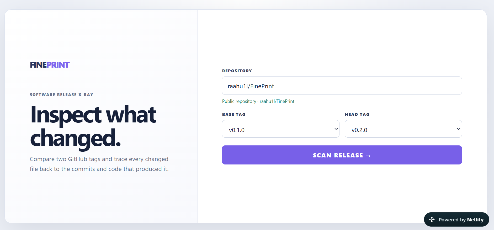
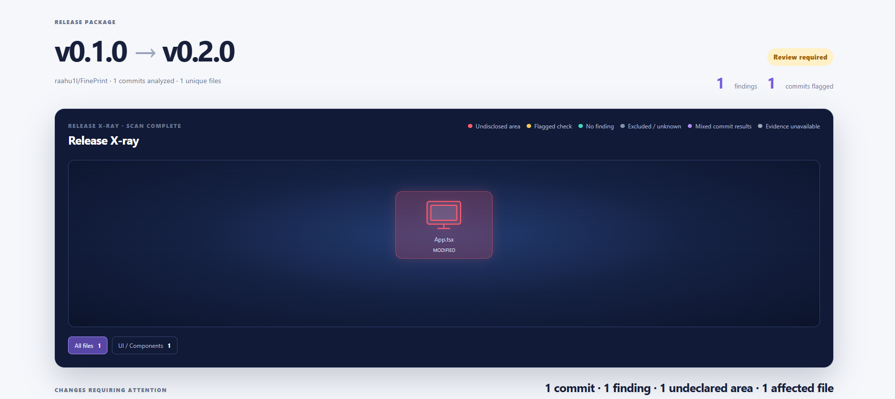
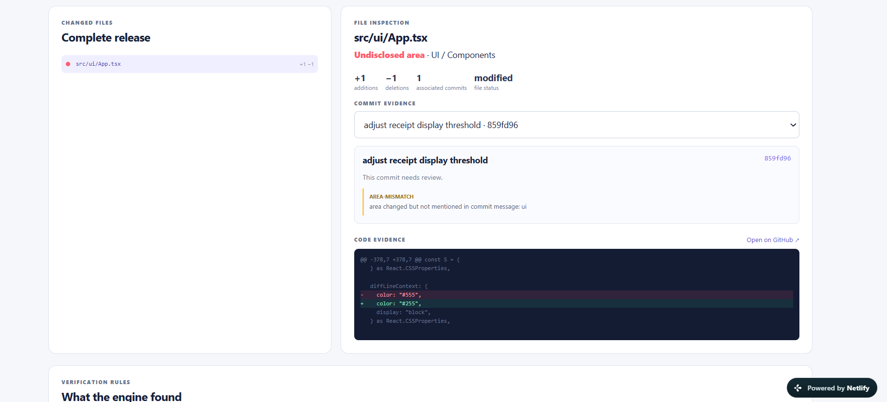

<div align="center">

# 🔍 FinePrint

**Release Notes, Verified Against Code.**

[](https://react.dev/)
[](https://www.typescriptlang.org/)
[](https://vitejs.dev/)
[](https://www.netlify.com/)
[]()

[](https://zesty-dasik-312180.netlify.app/)

</div>

---

## 📖 Description
FinePrint reads the real diff between two release tags and verifies each commit's message against what actually changed in the code. All analysis is rule-based and runs in the browser: no live AI call, no account, and no client-side secret. FinePrint started as an IBM Bob 2.0 Hackathon project and has since been improved well beyond the original submission.

## 🖥️ Screenshots

### 1. Scan Setup


### 2. Release X-ray Results


### 3. File Inspection and Code Evidence


## ❗ Problem
Changelog tools like GitHub auto-notes, Release Drafter, and semantic-release summarize what commit messages *say*. None of them check whether those messages are telling the truth. A "patch" release can hide a breaking change, and a commit can touch areas it never mentioned.

## 📱 Features
- **Diff-vs-message mismatch:** flags areas of the codebase that changed but were never mentioned in the commit message
- **Semver violation:** catches patch or minor bumps that secretly contain breaking changes (removed exports, changed function signatures)
- **Dependency bump:** flags any major-version jump in a dependency manifest, whatever the message says
- **Noise filtering:** auto-generated commits (release-plugin bumps, merge commits) are excluded
- **Release X-ray:** changed files grouped by category, linked to their commits, expandable to the real GitHub patch
- **Explainable results:** every finding shows which check triggered it

## 🧠 How It Works
1. Paste a public GitHub repo URL and pick two tags to compare.
2. FinePrint fetches every commit between the tags, with its full diff, through a Netlify Function proxy for GitHub's public REST API.
3. Each commit runs through the three checks (mismatch, semver, dependency bump).
4. Mechanical commits are filtered out so they never create false noise.
5. Results render as a release-level X-ray with the patch evidence behind every finding.

## 🛠️ Tech Stack
| Layer | Technology |
|------|-----------|
| Frontend | React, TypeScript, Vite |
| Backend | Netlify Functions (GitHub API proxy) |
| Data Source | GitHub REST API |
| Database | None required |
| Deployment | Netlify |

## 🏗️ Architecture
```
src/        # React app and analysis engine
netlify/    # Function proxy for the GitHub API
tests/      # Regression tests
docs/       # Screenshots
```

## 🤖 Built with IBM Bob 2.0
Built for the IBM Bob 2.0 Hackathon using Bob's Agent mode with full document understanding of the codebase. The three checks were built as three parallel subagents, spawned simultaneously, each implemented and tested independently, then merged into a single verdict engine. The project has been improved further since the hackathon build.
After the hackathon, I continued improving FinePrint independently:

- **Redesigned the results experience:** Replaced the original receipt-based UI with the Software Release X-ray, making changed files, categories and findings easier to explore.
- **Improved detection accuracy:** Refined area-mismatch rules and keyword matching to reduce false positives, including release-related documentation changes.
- **Strengthened testing and reliability:** Expanded regression coverage to 274 passing tests and added more edge-case validation.

## 🚀 Getting Started

### Prerequisites
- Node.js 18+

### Setup
```bash
git clone <repo-url>
cd <repo>
npm install
npm run dev
```

### Run Tests
Regression tests cover release aggregation, renames, file statuses, unavailable patches, mixed states, finding navigation, and the Netlify Function proxy.
```bash
npm test
npm run typecheck
npx tsc --noEmit -p tests/tsconfig.json
npm run test:functions
npm run build:ui
```

### Environment Variables
No variables are needed to run locally. A GitHub token is optional and stays server-side in the Netlify Function (never in frontend bundles):
```
GITHUB_TOKEN=
```

## 📄 License

This project was developed as part of the IBM Bob 2.0 Hackathon and is maintained as a personal project.

No open-source license has been applied yet. All rights to the source code remain with the author unless otherwise stated.

---

## 👨‍💻 Author

**Rahul Walawalkar**

GitHub: [@raahu1l](https://github.com/raahu1l)

Developed with curiosity, continuous learning, and the assistance of AI tools throughout implementation and debugging.

Thanks for stopping by! I hope you enjoy exploring this project as much as I enjoyed building it.

⭐ If you like this project or find it useful, consider giving it a star!